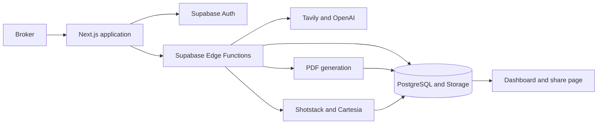

# PropShorts

An AI-assisted workspace for real estate brokers. PropShorts turns a client's property brief into a shortlist of public listings, a shareable PDF report, and a narrated vertical video.

## Features

- **Flexible input:** Capture a client brief through text, a property URL, or an uploaded voice recording.
- **Editable requirements:** Review and refine the interpreted budget, location, property type, and preferences before searching.
- **Source-backed discovery:** Search with Tavily and OpenAI, deduplicate listings, check geographic evidence, qualify property images, and rank candidates.
- **Generated packages:** Create a property comparison PDF and a combined short video with optional narration.
- **Broker workspace:** Manage recommendations, reports, videos, profile details, and subscriptions.
- **Sharing:** Publish a package through a dedicated share page.

## Architecture



The frontend handles input, review, and presentation. Supabase Edge Functions orchestrate transcription, requirement parsing, property discovery, and asset generation. PostgreSQL stores workflow records; Supabase Storage holds uploaded audio and generated assets.

Search providers run independently so one provider's failure does not stop the other. Candidate selection checks location evidence and source-linked images before ranking. The pipeline targets three recommendations and can continue with a smaller verified shortlist. A run with no qualifying properties returns a failure state so the broker can revise the brief.

## Technology

| Area | Implementation |
| --- | --- |
| Web application | Next.js App Router, React, TypeScript, Tailwind CSS |
| Authentication and data | Supabase Auth, PostgreSQL, Row Level Security |
| Storage and orchestration | Supabase Storage and Edge Functions |
| Property discovery | Tavily and OpenAI |
| Reports | `pdf-lib` in the server-side workflow |
| Video and narration | Shotstack and Cartesia; optional Remotion worker fallback |
| Billing | Stripe Checkout and webhooks |
| Web deployment | Netlify |

## Project Structure

```text
src/
  app/                 Application routes and screens
  components/          Shared UI components
  lib/                 Typed data access and client-safe transformations
  remotion/            Video compositions for the optional render worker
  render-worker/       Optional rendering service
  types/               Shared application types
supabase/
  functions/           Server-side workflows and provider integrations
  migrations/          Database schema and access policies
public/                Application assets
scripts/               Development and build utilities
```

## Local Development

Use Node.js 20 or later and npm.

```bash
npm ci
cp .env.example .env.local
```

On PowerShell, use `Copy-Item .env.example .env.local` for the second command. Fill in the public URL and anonymous key for your own Supabase project, then start the web application:

```bash
npm run dev
```

Open [localhost:3000](http://localhost:3000). Authentication and package generation require a configured Supabase backend; provider integrations also require their server-side credentials.

### Backend Configuration

Apply the migrations in `supabase/migrations` and deploy the functions in `supabase/functions` to your own Supabase project. Configure the corresponding Storage buckets and Auth redirect URLs for your environment.

Store provider credentials in Supabase secrets. The main integrations use:

| Integration | Server-side variables |
| --- | --- |
| Requirement parsing and discovery | `OPENAI_API_KEY`, `TAVILY_API_KEY` |
| Video rendering | `SHOTSTACK_API_KEY`; optional `SHOTSTACK_API_URL` |
| Narration | `CARTESIA_API_KEY`, `CARTESIA_VOICE_ID` |
| Billing | `STRIPE_SECRET_KEY`, `STRIPE_WEBHOOK_SECRET`, `STRIPE_STARTER_PRICE_ID`, `STRIPE_PRO_PRICE_ID`, `APP_BASE_URL` |
| Optional render worker | `REMOTION_RENDER_WEBHOOK_URL`, `REMOTION_RENDER_SECRET` |

The Edge Functions also use the Supabase-provided `SUPABASE_URL`, `SUPABASE_ANON_KEY`, and `SUPABASE_SERVICE_ROLE_KEY`. Only the two public variables in `.env.example` belong in the frontend environment.

### Checks

```bash
npm run lint
npm run typecheck
npm run build
```

`npm run check` runs linting, type checking, and a clean production build. Stop the development server before a production build because both use the `.next` directory.

## Deployment

`netlify.toml` configures the web build with Node.js 20 and `npm run check`. Set the public Supabase environment variables in Netlify, and deploy database migrations and Edge Functions separately to Supabase.

Broker records use ownership-based access policies. Public package sharing is a separate read path, and internal discovery traces are excluded from client-facing output.

## Current Scope

- The application focuses on the broker workflow.
- Recommendations use public web discovery; availability and listing details still need broker verification.
- Each run produces one combined package video. Narration is optional, and Shotstack sandbox output may include a watermark.
- Template changes apply to newly generated or rerendered assets.
