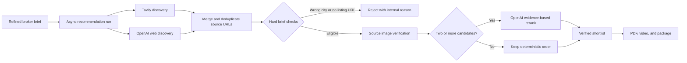

# PropShorts

PropShorts is an AI-powered real estate broker assistant. It helps a broker turn a client requirement into a polished property recommendation package with matched listings, a shareable PDF report, and a short narrated vertical video.

The MVP is broker-first. Client-facing access can be added later, but the current product focuses on broker authentication, package creation, generated assets, and sharing.


## What It Does

- Captures client requirements from text, URL, or voice input.
- Uses Supabase Auth for secure broker access.
- Refines requirements and searches public property matches through a resilient, source-backed server-side pipeline.
- Stores recommendations, internal traces, generated PDFs, videos, and package records in Supabase.
- Generates a designed PDF report with property details, comparison table, broker profile, and next-step call-to-action.
- Creates a vertical PropShort video using Shotstack, property images, and optional Cartesia voiceover.
- Exposes broker dashboard, PDF list, PropShort list, package detail, and public share routes.

## Stack

- **Frontend:** Next.js App Router, React, TypeScript, TailwindCSS
- **Auth / Database / Storage:** Supabase Auth, PostgreSQL, RLS, Storage
- **Backend workflow:** Supabase Edge Functions
- **PDF generation:** React-style layout logic built with `pdf-lib`
- **Video rendering:** Shotstack render API, orchestrated from Supabase Edge Functions
- **Voiceover:** Cartesia TTS, orchestrated from Supabase Edge Functions
- **Payments:** Stripe checkout and webhook functions
- **Frontend deployment:** Netlify

## Product Flow

1. Broker signs in.
2. Broker enters a client requirement from text, voice, or URL.
3. Supabase Edge Functions parse, transcribe, and refine the requirement.
4. An asynchronous recommendation run discovers public listings with Tavily and OpenAI web search in parallel.
5. The pipeline deduplicates candidates, applies source-backed geographic checks, verifies source-linked images, and ranks viable listings.
6. The PDF function generates a shareable report and uploads it to Supabase Storage.
7. The video function creates a `generated_videos` row, builds the Shotstack edit, and queues the Shotstack render.
8. Shotstack renders the vertical MP4, and the function stores the output status and URL in Supabase.
9. The package is finalized and shown in the dashboard, package screen, PDF screen, PropShort screen, and public share route.

## Property Discovery Pipeline



- Tavily and OpenAI run independently, so a provider failure does not stop the other provider.
- The city and locality rules are deterministic: a candidate is rejected when its source evidence conflicts with the brief.
- Only public, individual listing URLs and source-linked property images may reach the shortlist.
- Search uses bounded candidate pools, a single Tavily search/extract batch, one OpenAI discovery request, and at most one rerank request.
- If only one or two listings pass verification, the package continues with the verified shortlist; if none pass, the run fails safely and the broker can edit the same saved brief.

## Important Routes

- `/login`, `/signup`, `/forgot-password`, `/reset-password`
- `/dashboard`
- `/new-propshort`
- `/create/select`, `/create/write`, `/create/talk`, `/create/confirm`, `/create/processing/[runId]`
- `/packages/[packageId]`
- `/pdfs`, `/pdfs/[pdfId]`
- `/propshorts`, `/propshorts/[propshortId]`
- `/share/[shareSlug]`
- `/account`, `/tips`, `/plan`

## Supabase Functions

The main function folders live in `supabase/functions`:

- `submit-client-requirement`
- `parse-client-requirement`
- `transcribe-requirement-audio`
- `start-recommendation-run`
- `run-property-search`
- `process-recommendation-run`
- `generate-pdf-report`
- `generate-property-video`
- `rerender-property-video`
- `finalize-package`
- `create-checkout-session`
- `stripe-webhook`

Shared workflow and PDF/video orchestration helpers live in:

```text
supabase/functions/_shared/propshorts-pipeline.ts
```

## Data Model

Core tables include:

- `profiles`
- `client_requirements`
- `recommendation_runs`
- `property_recommendations`
- `property_internal_traces`
- `generated_pdfs`
- `generated_videos`
- `recommendation_packages`

Generated files are stored in Supabase Storage buckets such as:

- `requirement-audio`
- `generated-pdfs`
- `generated-videos`
- `property-images`

## Video Rendering

Supabase Edge Functions create the video record, generate the narration script, request Cartesia audio when enabled, build the Shotstack edit JSON, and queue the Shotstack render.

The active video format is documented in:

```text
docs/propshort-video-format.md
```

The Shotstack path:

- Uses real property images from the recommendation result.
- Keeps the broker block, metric badge, property text, PDF page, and call page aligned to the PropShorts format.
- Adds optional Cartesia narration to the render.
- Stores video status, provider job ID, narration transcript, and final video URL in Supabase.
- Falls back to the legacy webhook path only if Shotstack secrets are not configured.

## Local Development

Install dependencies:

```bash
npm install
```

Run the app:

```bash
npm run dev
```

Run checks:

```bash
npm run lint
npm run typecheck
npm run build
```

On this Windows setup, the global `npm`/`npx` shim may be broken. Use the NVM-managed executable when needed:

```powershell
C:\nvm4w\nodejs\npm.cmd run lint
C:\nvm4w\nodejs\npm.cmd run typecheck
```

## Environment Variables

Frontend:

```text
NEXT_PUBLIC_SUPABASE_URL=
NEXT_PUBLIC_SUPABASE_ANON_KEY=
```

Supabase Edge Functions:

```text
SUPABASE_URL=
SUPABASE_ANON_KEY=
SUPABASE_SERVICE_ROLE_KEY=
OPENAI_API_KEY=
TAVILY_API_KEY=
SHOTSTACK_API_KEY=
SHOTSTACK_API_URL=
CARTESIA_API_KEY=
CARTESIA_VOICE_ID=
STRIPE_SECRET_KEY=
STRIPE_WEBHOOK_SECRET=
```

Legacy fallback, only if the old render webhook path is used:

```text
REMOTION_RENDER_WEBHOOK_URL=
REMOTION_RENDER_SECRET=
```

Do not expose provider secrets in frontend code. Store provider secrets in Supabase secrets and frontend-only public variables in Netlify environment variables.

## Deployment

Frontend deployment is configured for Netlify:

```text
netlify.toml
```

Supabase function deployment is handled with the Supabase CLI or Supabase Management API.

## Development Rules

- Keep AI/API provider calls server-side only.
- Keep broker data private with Supabase RLS.
- Store generated assets in Supabase Storage.
- Keep PDF/video output client-safe; broker-only trace data must never appear in public output.
- Add loading, empty, success, and error states for user-facing screens.
- Keep the UI consistent with the PropShorts visual system: white surfaces, restrained grey panels, Poppins-style typography, clean spacing, and minimal ornament.

## Current Notes

- The app currently creates one combined PropShort package video per run.
- Property discovery uses parallel Tavily and OpenAI web research, with source-backed geography and image qualification before reranking.
- The Shotstack video path can render without narration if Cartesia is unavailable.
- Shotstack sandbox renders may include a watermark.
- Existing generated PDFs/videos do not automatically change after template updates; regenerate or rerender assets to see new templates.
